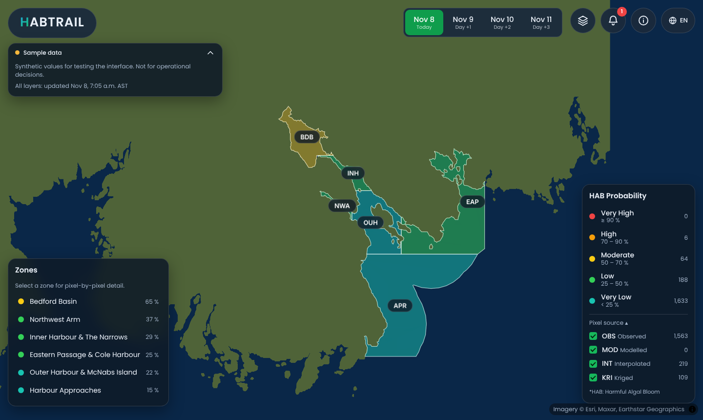
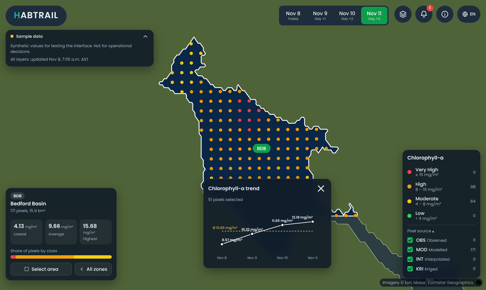

# HABTRAIL · Halifax Harbour prototype

A front-end prototype of a pixel-by-pixel harmful algal bloom (HAB) forecast dashboard for Halifax Harbour, Nova Scotia. It follows the pattern of the HABTRAIL web app: a dark satellite map, zone view with 300 m pixels, forecast date tabs, layer menu, alerts, and a species closure table.

**Every value on the map is synthetic sample data.** The interface is real; the numbers are not, and the page says so. No model has been built yet. The plan is front end first, then a data audit, then the model on whatever data turns out to be usable.




*Preview images were captured without satellite imagery (the imagery server was blocked where they were taken), so the land shows as the built-in fallback coastline. In a normal browser the basemap is satellite imagery.*

## What works

- **All-zones view**: six prototype zones coloured by the active layer, with clickable zone pills and a zone list (keyboard reachable).
- **Zone view**: every 300 m pixel as a dot, coloured by class, with hover or tap values.
- **Pixel source filter** (OBS observed, MOD modelled, INT interpolated, KRI kriged): show or hide pixels by where their value came from, with counts. This is the map-level filter requested in action A-05.
- **Layers**: HABtrail, Chlorophyll-a, SST, Salinity, Water Quality Index, Sediments (suspended matter), Shellfish closures.
- **Forecast dates**: today plus three days. Layers, legend counts, alerts and the closure table all follow the selected date.
- **Select area**: drag a box over pixels and get a trend card (line over the four dates with a dashed average).
- **Alerts**: worked out in the browser from the HABtrail layer for all forecast days (any pixel at or above the "high" class).
- **English and French**, **satellite or plain basemap**, **shareable links** (`#layer=chla&date=2026-11-09&zone=BDB&lang=fr`), phone layout, keyboard focus, reduced motion.

## Run it

No build step.

```bash
python3 -m http.server 8000
# open http://localhost:8000
```

Use a server rather than opening `index.html` directly, because the page loads JSON files.

## Publish on GitHub Pages

```bash
git remote add origin https://github.com/issahnazif-afk/habtrail-ns-prototype.git
git push -u origin main
```

Then in the repository: **Settings → Pages → Build and deployment → Deploy from a branch → `main` / `(root)`**. The site appears at `https://issahnazif-afk.github.io/habtrail-ns-prototype/`. All paths are relative, so it works under that sub-path.

`.github/workflows/refresh-sample-data.yml` regenerates the sample data daily so "today" stays current. It was written without being run, so check its first run in the Actions tab. Delete it once real data is wired in.

## How it is put together

```
index.html            page shell
css/styles.css        design tokens and layout (look follows the HABTRAIL app)
js/main.js            controller: state change -> load files -> one view -> map + panels
js/map.js             MapLibre: imagery, zones, pixel dots, zone pills, area selection
js/ui/*.js            top bar, legend, zone card, closures table, alerts/about, trend chart, tooltip
js/{state,data,classify,alerts,i18n,dom,icons}.js
data/                 meta.json, grid.json, zones.geojson, layers/<layer>/<date>.json
tools/                rebuild the grid, generate sample data, validate the data contract
tests/smoke.py        headless-Chrome end-to-end test (25 checks)
vendor/, fonts/       MapLibre GL JS and Poppins, vendored so the site has no CDN dependency
```

The front end and the data are separated by a fixed file format: [`docs/DATA_CONTRACT.md`](docs/DATA_CONTRACT.md). Replacing sample data with real model output means writing the same files; the interface does not change. Check them with `python3 tools/validate_data.py`.

## Rebuilding things

```bash
pip install -r tools/requirements.txt

python3 tools/make_sample_data.py              # new sample data for today
python3 tools/make_sample_data.py --start 2026-11-20
python3 tools/validate_data.py                 # check data against the contract
python3 tests/smoke.py                         # needs Chrome; saves screenshots to test-shots/
```

`tools/build_grid.py` rebuilds the pixel grid and zone polygons from `data/land_halifax.geojson`. `tools/extract_coast.py` rebuilt that coastline from the full-resolution GSHHG data in the `basemap-data-hires==2.0.0` package. You only need either if you change the zones or the study area.

## Assumptions to check

1. **Closure icons.** In the closure table a red ✕ means closed and a green ✓ means open. I inferred this from the screenshots of the Portuguese app; swap the icons in `js/ui/closures.js` if it is the other way round.
2. **Zones are not official.** Six zones (Bedford Basin, Northwest Arm, Inner Harbour and The Narrows, Outer Harbour and McNabs Island, Eastern Passage and Cole Harbour, Harbour Approaches) were drawn by hand in `tools/build_grid.py`. Pixels are limited to within 4.5 km of the coast.
3. **Thresholds are placeholders.** HAB probability bands (25 / 50 / 70 / 90 %) are copied from the Portuguese app. Chlorophyll-a, SST, salinity, WQI and sediment bands were chosen only to exercise every colour. Set them with domain input.
4. **Pixel size** is 300 m (Sentinel-3 OLCI scale), in UTM 20N.
5. **Closures** are entirely made up. Real closures come from the regulator, and that source has not been identified.
6. **Basemap**: Esri World Imagery, fine for a prototype with attribution. For production, change `ESRI_TILES` in `js/map.js` to a basemap you are licensed to use.
7. **No sign-in.** The Portuguese app has an account button; a static GitHub Pages site cannot authenticate anyone, so that slot is an About panel.

## Next steps

1. **Data audit.** Find out which variables COVE Digital Harbour and its partners actually publish for Nova Scotia (their app could not be inspected automatically), their update frequency and licence, and whether any bloom or toxin observations exist to train on.
2. **Pick the first real layer.** Likely SST or chlorophyll-a from satellite, because those need no ground-truth labels.
3. **Model.** Only after steps 1 and 2: decide what can honestly be forecast from the data found, and validate it before it is shown as a forecast.

See `NOTICE.md` for third-party material and licences.
